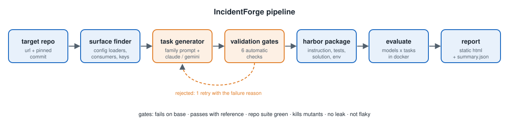

# IncidentForge

**A coding task factory whose tasks come from what actually breaks in production.**

IncidentForge takes any repository pinned at a commit and turns it into feature-development tasks for
evaluating AI coding systems. Each task asks the model to add the protection that would have prevented a
recurring class of production outage, ships in [Harbor](https://github.com/harbor-framework/harbor) format,
and is kept only after six automatic validation gates pass.

> Innodata AI Hackathon 2026 · Track 1 (Coding Task Factory) · Team CHAOS · MIT licence

## The problem

Most generated coding benchmarks ask a model to "invent a feature for this repo". The resulting tasks
are generic, exercise the happy path, and say little about whether the code would survive production.
In a large e-commerce microservice fleet, a small number of failure classes cause a large share of real
outages: services that crash on a missing setting, configs written in a format the parser does not
accept, impossible settings combinations, reloads that never take effect, and so on. These are exactly
the paths AI-written code tends to skip.

## Task families

Eight families, each derived from a recurring production failure class. Every task pairs feature tests
with **fault-injection tests** that recreate the failure.

| # | Family | The model must… | Fault the tests inject |
|---|---|---|---|
| 1 | `fail-fast-config` | refuse to start on missing or empty required settings, with a clear error | required setting unset / blank |
| 2 | `tolerant-typed-config` | parse list/number/bool settings from the formats operators actually write | `"a, b"`, `"1_000"`, `"Yes"`, garbage |
| 3 | `cross-field-validation` | reject impossible combinations | start after end, min above max |
| 4 | `idempotent-consumer` | apply a duplicate or retried message only once | redelivery, retry after partial failure |
| 5 | `hot-reload-config` | make dynamic values take effect without a restart | value changed at runtime |
| 6 | `env-aware-naming` | keep cache/queue keys correct across environments | same key in two environments |
| 7 | `resource-aware-defaults` | derive pool/worker sizes from limits, not constants | small container limit |
| 8 | `config-round-trip` | regenerate config without dropping or defaulting fields | load → save → load diff |

Details and a sample task per family: [docs/families.md](docs/families.md).

## How it works



1. **Target**: a repo URL + pinned commit + an environment template (Dockerfile and a `run_tests` helper) in
   `src/incidentforge/targets/`.
2. **Surface finder**: locates code a family can attach to (settings classes, env reads, validators,
   message handlers, cache keys, config writers, pool settings), for Python and Go.
3. **Generator**: a family prompt plus the surface go to a backend (Claude Code headless or Gemini), which
   returns the instruction, a reference patch, feature tests and the fault cases.
4. **Validation gates**: the task is accepted only if the tests fail on the base commit, pass with the
   reference patch, the repo's own suite stays green, mutated reference patches are caught, the
   instruction does not leak the solution, and the tests are stable across reruns. A rejected task gets
   one retry with the failure reason fed back.
5. **Package**: a complete Harbor task directory (see [docs/task-format.md](docs/task-format.md)).
6. **Evaluate and report**: Harbor runs each model on every task in Docker; `forge report` writes a static
   HTML report and `reports/summary.json`.

Module map and data flow: [docs/architecture.md](docs/architecture.md).

## Quickstart

Requirements: Python 3.12, [uv](https://docs.astral.sh/uv/), Docker, and the Harbor CLI
(`uv tool install harbor==0.26.0`). For generation, either the Claude Code CLI or a Gemini API key.

```bash
git clone https://github.com/Pr1ncePS2002/incidentforge && cd incidentforge
uv sync
cp .env.example .env            # add GEMINI_API_KEY (free tier is enough to generate)

# generate, validate and keep tasks for a target
uv run forge run --target fastapi-template --family fail-fast-config --n 2

# re-run every validation gate on the dataset
uv run forge validate tasks

# check the tasks in Harbor: the reference solution scores 1.0, doing nothing scores 0.0
harbor run -p tasks/fastapi-template -a oracle
harbor run -p tasks/fastapi-template -a nop

# evaluate models and build the report
uv run forge eval --tasks tasks --model gemini/gemini-3.8-flash
uv run forge report             # writes reports/index.html

# paid-key spend against the hard cap
uv run forge budget
```

## Adding a new target repo

1. Add `src/incidentforge/targets/<name>.yaml` with `repo_url`, `commit`, `language` (`python` | `go`),
   `env_template`, `test_command` and `source_root`.
2. Copy the closest env template under `src/incidentforge/targets/env/` and adjust the Dockerfile so the
   repo's own test suite passes via `run_tests`.
3. `uv run forge run --target <name> --n 3`.

`scripts/finale_dry_run.sh <repo_url> <commit> <language>` does all three and prints timings; the event
playbook is in [docs/finale-playbook.md](docs/finale-playbook.md).

## Results

Two target repos: `fastapi-template` (Python, 24 tasks) and `miniflux` (Go, 10 tasks). On a repo the pipeline
had never seen (python-dotenv), `scripts/finale_dry_run.sh` produced 3 accepted tasks in 20 minutes.

<!-- results:start (generated by scripts/readme_results.py from reports/summary.json) -->

| | Value |
|---|---|
| Tasks in the dataset | 34 across 8 families |
| Candidates passing every gate | 34 of 34 |
| Mutants killed by accepted tasks' tests | 179 of 201 (89%) |
| Paid API spend | $43.96 (hard cap $70) |

| Model | Agent | Runs | Pass rate |
|---|---|---|---|
| claude-code | claude-code | 54 (up to k=3 per task) | 98% |
| gemini/gemini-2.5-flash | terminus-2 | 54 (up to k=3 per task) | 33% |
| gemini/gemini-3.8-flash | terminus-2 | 54 (up to k=3 per task) | 28% |

Where failed runs break (failing test kinds per model):

| Model | Fault-injection tests | Happy-path tests | Repo suite |
|---|---|---|---|
| claude-code | 1 | 0 | 0 |
| gemini/gemini-2.5-flash | 23 | 9 | 13 |
| gemini/gemini-3.8-flash | 26 | 12 | 1 |

Findings:

- 34 of 34 tasks with a validation report passed every gate; accepted tasks' tests killed 179 of 201 injected mutants (89%).
- pass rate by model: claude-code 98% (54 runs), gemini/gemini-2.5-flash 33% (54 runs), gemini/gemini-3.8-flash 28% (54 runs) (agents differ: claude-code, terminus-2; compare models within one agent).
- hardest family is config-round-trip (33% of 21 runs across all models); easiest is env-aware-naming (86% of 21 runs).
- of failed runs with per-test detail, 50 failed at least one injected fault-case test and 21 at least one happy-path test.
- each of the 76 failed runs has one cause: 52 used every turn, 1 broke the repo's own tests, 13 missed an injected fault, 10 wrong code.
- gemini/gemini-4-hydrogen was left out of scoring: through terminus-2 (litellm) nearly every turn came back empty or unparseable, so the agent barely acted; a 0% would measure the harness, not the model.
- gemini/gemini-2.5-flash with 60 turns instead of 30: 30% -> 40% on 10 tasks; of its 36 main-run failures, 17 used every turn and 19 stopped before the cap.
- gemini/gemini-3.8-flash with 60 turns instead of 30: 30% -> 80% on 10 tasks; of its 39 main-run failures, 35 used every turn and 4 stopped before the cap.

Generated 2026-11-21T18:39:17+0530. Full per-family breakdown: `reports/index.html`.
<!-- results:end -->

Refresh this block with `uv run python scripts/readme_results.py` after `forge report`.

## Validation evidence

Every accepted task has a JSON log in `reports/validation/<task_id>.json` with the result and timing of each
gate and the number of mutants killed. CI re-runs the oracle and no-op agents on every committed task
before anything reaches `main`, and nightly on `develop`.

## Cost control

All Gemini calls go through one backend that tries the free key first. The paid key is used only under a
hard spend cap checked **before** each call against a local ledger; `forge budget` shows spend against the
cap and whether the remaining evaluation fits.

## Limitations

- Task families target configuration, startup and message-handling code; they do not cover UI or
  performance work.
- Targets need a Dockerised test suite that runs offline in a single container.
- Generated tasks are only as diverse as the surfaces found in the repo; a small repo yields fewer tasks
  per family.
- Model results are from single runs (k=1) on the full set plus k=3 on a subset, so small differences are
  within noise.
- The two evaluated agents differ (Claude Code vs terminus-2), so pass rates compare models only within one
  agent. terminus-2 results depend on its turn budget (30 turns in the main run; see the ablation above).

## Development

```bash
uv lock --check && uv run ruff check src tests && uv run ruff format --check src tests \
  && uv run mypy && uv run pytest -q --cov
```

Branches: `ftr/*` → `develop` → `main`. CI gates: lint (ruff, mypy strict), unit tests (branch coverage
≥ 75%), security (secret scan, dependency audit), and a Docker integration stage before `main`.

## Licence

[MIT](LICENSE)
