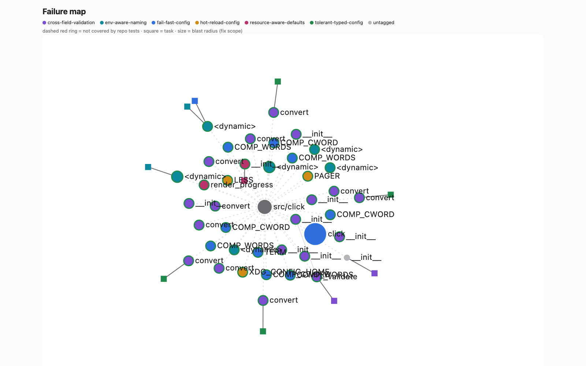

# IncidentForge

**A coding task factory whose tasks come from what actually breaks in production.**

IncidentForge reads a repository pinned at a commit and produces validated feature-development tasks in
[Harbor](https://github.com/harbor-framework/harbor) format. Each task asks for the protection that would
have prevented a recurring class of production outage, and is kept only after six automatic validation gates
pass. The submission dataset is built on **[pallets/click](https://github.com/pallets/click) 8.5.1**
(commit `cf19179e8e2fd54c601378cec9e0d21bb12b6fb1`).

> Innodata AI Hackathon 2026 · Track 1 (Coding Task Factory) · Team CHAOS · MIT licence

[](https://codespaces.new/Pr1ncePS2002/incidentforge?quickstart=1)
· **Live report:** [pr1nceps2002.github.io/incidentforge](https://pr1nceps2002.github.io/incidentforge/)
· **Failure map:** [map.html](https://pr1nceps2002.github.io/incidentforge/map.html)
· **Demo video:** <!-- demo: add video link --> TBD
· **Technical explanation:** [docs/technical-explanation.md](docs/technical-explanation.md)

## The problem

Most generated coding benchmarks ask a model to "invent a feature for this repo". The resulting tasks are
generic, exercise the happy path, and say little about whether the code would survive production. In a large
e-commerce platform's microservice fleet, a small number of failure classes cause a large share of real
outages: services that crash on a missing setting, values written in a format the parser does not accept,
impossible settings combinations, reloads that never take effect, and so on. These are exactly the paths
AI-written code tends to skip.

## Task families

Eight families, each derived from a recurring production failure class. Every task pairs feature tests with
**fault-injection tests** that recreate the failure.

| # | Family | The model must… | Fault the tests inject |
|---|---|---|---|
| 1 | `fail-fast-config` | refuse to start on missing or empty required settings, with a clear error | required setting unset / blank |
| 2 | `tolerant-typed-config` | parse list/number/bool settings from the formats operators actually write | `"a, b"`, `"1_000"`, `"Yes"`, garbage |
| 3 | `cross-field-validation` | reject impossible combinations | start after end, min above max |
| 4 | `idempotent-consumer` | apply a duplicate or retried message only once | redelivery, retry after partial failure |
| 5 | `hot-reload-config` | make dynamic values take effect without a restart | value changed at runtime |
| 6 | `env-aware-naming` | keep cache/queue keys correct across environments | same key in two environments |
| 7 | `resource-aware-defaults` | derive pool/worker sizes from limits, not constants | small container limit |
| 8 | `config-round-trip` | regenerate config without dropping or defaulting fields | load → save → load diff |

Details and sample tasks per family: [docs/families.md](docs/families.md).

## How it works


1. **Target**: a repo URL + pinned commit + an environment template (Dockerfile and a `run_tests` helper) in
   `src/incidentforge/targets/`.
2. **Failure map**: a code graph of the repo (from [code-review-graph](https://github.com/tirth8205/code-review-graph)
   plus our own config-read, env-read and handler nodes), each node tagged with the failure families that can
   attach to it, its blast radius, and whether a real test run covers it. Surfaces are ranked so untested
   code comes first. The flat AST surface finder for Python and Go stays as the fallback.
3. **Generator**: a family prompt plus the surface go to a backend (Claude Code headless or Gemini), which
   returns the instruction, a reference patch, feature tests and the fault cases. With `--workers N`, one
   worker runs per map cluster (no two clusters share a file) under a shared cap of Docker containers.
4. **Validation gates**: the task is accepted only if the tests fail on the base commit, pass with the
   reference patch, the repo's own suite stays green, mutated reference patches are caught, the
   instruction does not leak the solution, and the tests are stable across reruns. A rejected task gets
   one retry with the failure reason fed back.
5. **Package**: a complete Harbor task directory (see [docs/task-format.md](docs/task-format.md)).
6. **Evaluate and report**: Harbor runs each model on every task in Docker; `forge report` writes a static
   HTML report, `reports/summary.json` and the failure map page `reports/map.html`. Each failed run gets one
   cause: it ran out of turns, broke the repo's own tests, missed an injected fault, or wrote wrong code.

**From a postmortem:** `forge from-postmortem <url> --target <name>` classifies a public incident report into
a family and a trigger, picks the best surface from the map, and runs the same generator and gates. The
report's URL is kept in the task's `source_url`.

**Difficulty** is labelled by the number of injected fault cases (easy ≤ 3, medium 4–5, hard ≥ 6). The size
of the fix is a separate `fix_scope` label (1 file, 2–3 files, 4+ files) taken from the blast radius.



Module map and data flow: [docs/architecture.md](docs/architecture.md). Design decisions, assumptions,
reused components, models and the variation strategy: [docs/technical-explanation.md](docs/technical-explanation.md).

## Setup

Requirements: Python 3.12, [uv](https://docs.astral.sh/uv/), Docker (running), Git, and the Harbor CLI
(`uv tool install harbor==0.25.0`). For generation, any logged-in coding CLI (Claude Code, Codex, opencode,
Gemini CLI or your own command, see below) or a Gemini API key in `.env`.

```bash
git clone https://github.com/Pr1ncePS2002/incidentforge && cd incidentforge
uv sync
cp .env.example .env            # add GEMINI_API_KEY if you use the gemini backend or gemini models
uv run pytest -q                # unit tests, no docker needed
```

Or open the repo in Codespaces with the badge above: the container comes with Docker, uv and Harbor installed.

## Quickstart on click

```bash
# 1. failure map of click at the pinned commit (code graph, family tags, coverage from one real test run)
uv run forge map build --target click --coverage

# 2. generate, validate and keep tasks; one worker per map cluster
uv run forge run --target click --n 12 --workers 4

# 3. re-run every validation gate on the click tasks
uv run forge validate tasks/click

# 4. the validation matrix for one task: doing nothing scores 0.0, the reference solution scores 1.0
harbor run -p tasks/click/<task-id> -a nop    -k 1 -o jobs/nop    --no-delete -y
harbor run -p tasks/click/<task-id> -a oracle -k 1 -o jobs/oracle --no-delete -y

# 5. evaluate models and build the report
uv run forge eval --tasks tasks --only click/ --model gemini/gemini-3.8-flash
uv run forge report             # writes reports/index.html, reports/summary.json and reports/map.html
```

One task from a public postmortem: `uv run forge from-postmortem <url> --target click`.

## Run it on your own repo with any coding CLI

No LLM API key is needed: generation calls a coding CLI you are already logged in to, headless, with its
tools turned off and an empty working directory, and parses one JSON object from its answer.

| `--backend` | runs |
|---|---|
| `claude-code` (default) | `claude -p --output-format json --json-schema <schema> --tools ""` |
| `codex` | `codex exec -s read-only -c approval_policy="never" --ignore-user-config -o <file> -` |
| `opencode` | `opencode run --pure --format json`, every tool permission denied; `--model provider/model` |
| `gemini-cli` | `gemini --output-format json -e none -p ...` (built from its documented flags, tested with a fake binary only) |
| `command` | anything else: `--backend-command` or `FORGE_GEN_COMMAND`, prompt on stdin or in `{prompt_file}`, JSON on stdout |
| `auto` | the first of `claude`, `codex`, `opencode`, `gemini` found on `PATH` (login is not checked) |

```bash
uv run forge run --target click --n 1 --backend codex
# any cli that prints the answer to stdout; this one is the one we smoke-tested
FORGE_GEN_COMMAND="claude -p --output-format text --tools ''" uv run forge run --target click --backend command
```

Validation, the six gates and Harbor's nop/oracle matrix need no LLM at all. For your own repo,
`FORGE_BACKEND=<backend> scripts/finale_dry_run.sh <repo_url> <commit> <python|go>` scaffolds the target,
checks its test suite in Docker and generates tasks (see [Adding a new target repo](#adding-a-new-target-repo)).
If a CLI is logged out, each rejected pair prints the CLI's error under it.

`forge eval` also runs your tasks against Harbor's CLI agents on your own login. Each job sees only that
agent's credentials, never the Gemini keys: `claude-code` (`CLAUDE_CODE_OAUTH_TOKEN`), `codex`
(`~/.codex/auth.json` or `OPENAI_API_KEY`), `gemini-cli` (`~/.gemini/oauth_creds.json`), `opencode`
(provider keys) and `cursor-cli` (`CURSOR_API_KEY`). The committed results cover Claude Code and Gemini only.

```bash
uv run forge eval --agent codex --only click/                  # the CLI's default model
uv run forge eval --agent codex --model openai/gpt-5.5 --only click/tt-001-convert
```

## Task package

Each task lives in `tasks/<target>/<task-id>/` and is tagged to its starting commit (`base_commit` in
`task.toml`):

```
task.toml          # repo_url, base_commit, licence, family, difficulty, fault cases, timeouts
instruction.md     # the only file the agent sees
environment/       # Dockerfile building the repo at base_commit, run_tests helper
solution/          # reference patch and solve.sh (used by the oracle agent)
tests/             # feature + fault-injection tests, test.sh, fail_to_pass.json, pass_to_pass.json
```

Reward: 0.0 if any regression test fails, 1.0 if every feature test passes, otherwise the share of feature
tests that pass. Full format: [docs/task-format.md](docs/task-format.md).

## Validation evidence

- **Gate logs**: every accepted task has `reports/validation/<target>/<task-id>.json` with the result,
  detail and timing of each gate and the number of mutants killed.
- **Evaluation logs**: one row per run in `reports/eval/results.jsonl` and `reports/eval/trials.jsonl`
  (reward, turns, tokens, per-test failures); excluded models and why in `reports/eval/excluded.json`.
- **Execution metrics and failure cases**: `reports/summary.json` and `reports/index.html` (pass rates,
  failure causes per run, per-family breakdown, turn-budget ablation).
- **Mutation testing**: the `mutation` gate per task, plus nightly mutmut over our own gate code.
- **Manual fixes**: every hand change to the dataset is listed in
  [docs/technical-explanation.md](docs/technical-explanation.md#manual-fixes).
- **CI**: the `integration` job re-runs the oracle and no-op agents on every committed task before
  anything reaches `main`, and nightly on `develop`.

## Results on click

Click dataset: 10 tasks over five families (tolerant-typed 4, cross-field 2, env-aware-naming 2, fail-fast 1,
resource-aware-defaults 1) from 18 generations; 14 passed every gate and 4 were dropped on review, none
hand-edited. On Harbor 0.25.0 the no-op agent scores 0.0 and the oracle 1.0 on all 10. Headline: five Claude
models through the claude-code agent solved every task, while gemini-3.8-flash solved 4 of 10 and
gemini-2.5-flash 2 of 10 through terminus-2, mostly by running out of turns.

<!-- results:start (generated by scripts/readme_results.py from reports/summary.json) -->

| | Value |
|---|---|
| Tasks in the dataset | 10 across 5 families |
| Generated candidates | 18 |
| Passing every gate | 14 of 18 |
| Kept in the dataset | 10 (4 dropped on review) |
| Mutants killed by accepted tasks' tests | 55 of 56 (98%) |
| No-op agent scores 0.0 | 10 of 10 (Harbor 0.25.0) |
| Oracle agent scores 1.0 | 10 of 10 (Harbor 0.25.0) |

Models on the click tasks (pass rate = share of runs with reward 1.0; mean reward also counts partial credit):

| Model | Agent | Runs | Pass rate | Mean reward |
|---|---|---|---|---|
| claude-code:anthropic/claude-fable-5-2 | claude-code | 10 (k=1) | 100% | 1.00 |
| claude-code:anthropic/claude-haiku-5-5 | claude-code | 10 (k=1) | 100% | 1.00 |
| claude-code:anthropic/claude-opus-5-5 | claude-code | 10 (k=1) | 100% | 1.00 |
| claude-code:anthropic/claude-sonnet-5-5 | claude-code | 10 (k=1) | 100% | 1.00 |
| claude-code (default) | claude-code | 10 (k=1) | 100% | 1.00 |
| gemini/gemini-3.8-flash | terminus-2 | 10 (k=1) | 40% | 0.40 |
| gemini/gemini-2.5-flash | terminus-2 | 10 (k=1) | 20% | 0.20 |

Why failed runs failed (one cause per run):

| Model | Used every turn | Broke the repo's own tests | Missed an injected fault | Wrong code |
|---|---|---|---|---|
| gemini/gemini-2.5-flash | 7 | 1 | 0 | 0 |
| gemini/gemini-3.8-flash | 6 | 0 | 0 | 0 |

Findings:

- 10 of 10 tasks with a validation report passed every gate; accepted tasks' tests killed 55 of 56 injected mutants (98%).
- pass rate by model: claude-code (default) 100% (10 runs), claude-code:anthropic/claude-sonnet-5-5 100% (10 runs), claude-code:anthropic/claude-haiku-5-5 100% (10 runs), claude-code:anthropic/claude-opus-5-5 100% (10 runs), claude-code:anthropic/claude-fable-5-2 100% (10 runs), gemini/gemini-3.8-flash 40% (10 runs), gemini/gemini-2.5-flash 20% (10 runs) (agents differ: claude-code, terminus-2; compare models within one agent).
- hardest family is fail-fast-config (71% of 7 runs across all models); easiest is cross-field-validation (93% of 14 runs).
- of failed runs with per-test detail, 14 failed at least one injected fault-case test and 7 at least one happy-path test.
- each of the 14 failed runs has one cause: 13 used every turn, 1 broke the repo's own tests, 0 missed an injected fault, 0 wrong code.

Generated 2026-11-24T20:52:17+0530. Full per-family breakdown: `reports/index.html`.
<!-- results:end -->

Refresh this block with `uv run python scripts/readme_results.py` after `forge report`.

## Also runs on other repositories

Extra evidence that the factory is not tied to one repo. These repositories are not starter repositories for
the hackathon, so their tasks are **not** part of the submission dataset and are kept out of the headline
numbers above. They were measured with the earlier all-or-nothing reward and Harbor 0.26.0.

Two repos: `fastapi-template` (Python, 33 tasks, 3 of them from public postmortems by Cloudflare, Heroku and
AWS) and `miniflux` (Go, 19 tasks), in `tasks/fastapi-template/` and `tasks/miniflux/`. On a repo the
pipeline had never seen (python-dotenv), `scripts/finale_dry_run.sh` produced 3 accepted tasks in 20 minutes.

| | Value |
|---|---|
| Tasks in the dataset | 52 across 8 families |
| Candidates passing every gate | 52 of 52 |
| Mutants killed by accepted tasks' tests | 276 of 309 (89%) |

| Model | Agent | Runs | Pass rate |
|---|---|---|---|
| claude-code | claude-code | 70 (up to k=3 per task) | 99% |
| gemini/gemini-2.5-flash | terminus-2 | 72 (up to k=3 per task) | 36% |
| gemini/gemini-3.8-flash | terminus-2 | 72 (up to k=3 per task) | 32% |

Where failed runs break (failing test kinds per model):

| Model | Fault-injection tests | Happy-path tests | Repo suite |
|---|---|---|---|
| claude-code | 1 | 0 | 0 |
| gemini/gemini-2.5-flash | 26 | 12 | 20 |
| gemini/gemini-3.8-flash | 32 | 17 | 3 |

Findings:

- 52 of 52 tasks with a validation report passed every gate; accepted tasks' tests killed 276 of 309 injected mutants (89%).
- pass rate by model: claude-code 99% (70 runs), gemini/gemini-2.5-flash 36% (72 runs), gemini/gemini-3.8-flash 32% (72 runs) (agents differ: claude-code, terminus-2; compare models within one agent).
- hardest family is config-round-trip (33% of 27 runs across all models); easiest is env-aware-naming (83% of 24 runs).
- of failed runs with per-test detail, 59 failed at least one injected fault-case test and 29 at least one happy-path test.
- each of the 96 failed runs has one cause: 70 used every turn, 1 broke the repo's own tests, 13 missed an injected fault, 12 wrong code.
- gemini/gemini-4-hydrogen was left out of scoring: through terminus-2 (litellm) nearly every turn came back empty or unparseable, so the agent barely acted; a 0% would measure the harness, not the model.
- gemini/gemini-2.5-flash with 60 turns instead of 30: 30% -> 40% on 10 tasks; of its 46 main-run failures, 25 used every turn and 21 stopped before the cap.
- gemini/gemini-3.8-flash with 60 turns instead of 30: 31% -> 75% on 16 tasks; of its 49 main-run failures, 45 used every turn and 4 stopped before the cap.

## Adding a new target repo

1. Add `src/incidentforge/targets/<name>.yaml` with `repo_url`, `commit`, `language` (`python` | `go`),
   `env_template`, `test_command` and `source_root`.
2. Copy the closest env template under `src/incidentforge/targets/env/` and adjust the Dockerfile so the
   repo's own test suite passes via `run_tests`.
3. `uv run forge run --target <name> --n 3`.

`scripts/finale_dry_run.sh <repo_url> <commit> <language>` does all three and prints timings; the event
playbook is in [docs/finale-playbook.md](docs/finale-playbook.md).

## Limitations

- Task families target configuration, startup, input-validation and message-handling code; they do not
  cover UI or performance work.
- Targets need a Dockerised test suite that runs offline in a single container.
- Generated tasks are only as diverse as the surfaces found in the repo; a small repo yields fewer tasks
  per family.
- Model results come from few runs per task, so small differences are within noise.
- Difficulty labels come from fault-case counts; blast radius alone did not track pass rate, so it is kept
  as a separate fix-scope label rather than a difficulty.
- The evaluated agents differ (Claude Code vs terminus-2), so pass rates compare models only within one
  agent. terminus-2 results depend on its turn budget.
- Two click tasks have known test gaps, kept as generated rather than hand-edited: `tt-001-convert` has no
  zero-duration test case, and `tt-003-convert` has four `test_fault_garbage_*` tests that already pass on
  the base commit (garbage input was already rejected), so they act as guards, not fault tests.

## Development

```bash
uv lock --check && uv run ruff check src tests && uv run ruff format --check src tests \
  && uv run mypy && uv run pytest -q --cov
```

Branches: `ftr/*` → `develop` → `main`. CI gates: lint (ruff, mypy strict), unit tests (branch coverage
≥ 90%), security (secret scan, dependency audit), and a Docker integration stage before `main`.

## Licence

IncidentForge is [MIT](LICENSE) licensed. Generated task packages contain code and patches against the
target repositories, which keep their own licences, recorded in each task's `task.toml`: pallets/click is
BSD-3-Clause.
