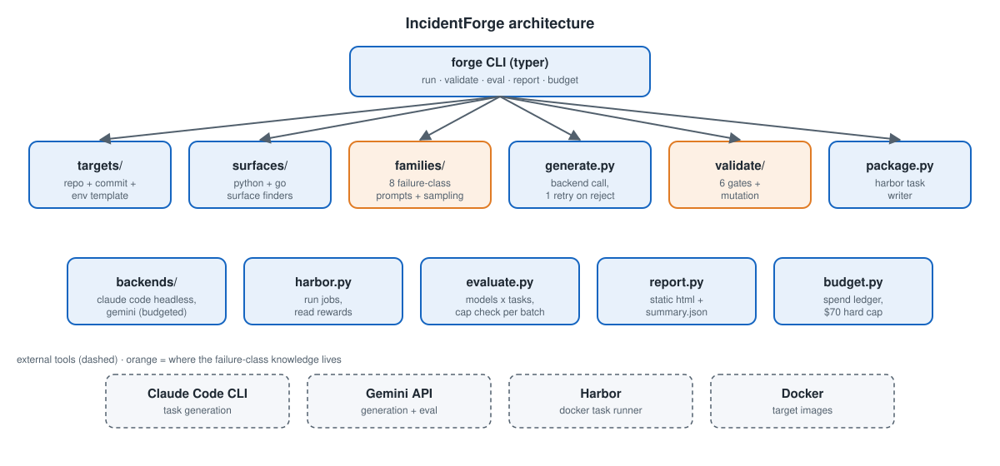

# Architecture

Diagrams are generated by `uv run python scripts/diagrams.py` (stdlib only, writes `docs/img/*.svg`).

## Pipeline stages

| Stage | Module | Input → output |
|---|---|---|
| 1. Target | `targets/<name>.yaml`, `targets/env/<name>/` | repo URL + pinned commit + env template → `Target` |
| 2. Surfaces | `surfaces/python.py`, `surfaces/go.py` | checked-out repo → `list[Surface]` (file, symbol, kind, excerpt) |
| 2a. Failure map | `failmap/` | repo → `work/<target>/map.sqlite` + `map.json`: code graph from code-review-graph plus our own config-read, env-read and handler nodes, family tags, blast radius, clusters, and test coverage from one real run per commit |
| 3. Family pick | `families/sampling.py`, `families/<slug>/` | requested count → families, frequency-weighted by how often the failure class occurs; surfaces ranked so untested code comes first |
| 3a. Parallel plan | `parallel.py` | map clusters → one worker per cluster; no two clusters share a file, Docker containers capped by a shared slot pool, task ids assigned once at merge under a file lock |
| 4. Generate | `generate.py`, `backends/` | family prompt + surface → `TaskSpec` (instruction, reference patch, feature tests, fault cases) |
| 5. Package | `package.py` | `TaskSpec` → Harbor task directory under `tasks/<target>/<task-id>/` |
| 6. Validate | `validate/` | task directory → `ValidationReport` + `reports/validation/<task_id>.json` |
| 7. Retry | `generate.py` | rejected task → one regeneration with the failing gate's reason in the prompt |
| 8. Evaluate | `evaluate.py`, `harbor.py` | tasks × models → `list[EvalResult]` (reward, tokens, cost) |
| 9. Report | `report.py` | eval results + validation logs → `reports/index.html`, `reports/summary.json`; every failed run gets exactly one cause (turn budget, regression, missed fault, wrong code) |
| 10. Map page | `map_render.py` | failure map + tasks → `reports/map.html` (D3 inlined, works offline): nodes by family and blast radius, tasks pinned to nodes |

`forge run` covers stages 1–7 (`--workers N` for 3a), `forge validate` re-runs stage 6, `forge eval` stage 8,
`forge report` stages 9–10, and `forge map build | backfill | render` the map on its own.
`forge from-postmortem <url> --target <name>` classifies a public incident report into a family and a trigger,
picks the best surface from the map and runs stages 4–7 on it, writing `source_url` into the task metadata.

Task difficulty comes from the number of fault cases (easy ≤ 3, medium 4–5, hard ≥ 6); the size of the fix
is a separate `fix_scope` label from the blast radius (1 file, 2–3 files, 4+ files). Blast radius alone was
inversely correlated with pass rate, so the two are kept apart.

## Shared contracts

All stages exchange the pydantic models in `src/incidentforge/models.py`: `Target`, `Surface`, `TaskSpec`,
`GateResult`, `ValidationReport`, `EvalResult`. A stage can be replaced (for example a new language's
surface finder) without touching the others as long as it returns these types.

## Backends

- **Claude Code headless** (`backends/claude_code.py`): `claude -p --output-format json`, used for generation.
- **Gemini** (`backends/gemini.py`): free key first; a paid fallback key only under the hard cap in
  `budget.py`, checked before every call against an append-only spend ledger.

Both implement `Backend.generate_json(prompt, schema)`, so families and the generator do not know which
model produced a task.

## Execution environment

Each target has one Docker image built from its env template: the repo checked out at the pinned commit,
dependencies installed, and any service it needs (for example Postgres) running inside the same container.
Harbor runs the agent and then the verifier in that container (`environment_mode = "shared"`), so the tests
see exactly the code the agent left behind.

## CI

`.github/workflows/ci.yml`: `lint` (lockfile, ruff, mypy strict), `unit` (pytest, branch coverage ≥ 90%),
`security` (secret scan, dependency audit, no tracked `.env`) on every PR; `integration` (image builds, repo
suites, oracle = 1.0 and no-op = 0.0 on every committed task) before `main`, nightly on `develop`, and on
demand. `.github/workflows/pages.yml` publishes `reports/` (report and failure map) to GitHub Pages from
`main`; `.devcontainer/` gives a Codespace with Docker, uv and Harbor ready.
